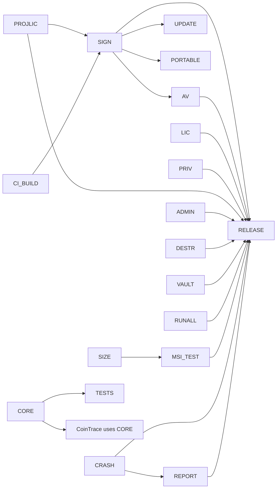

# Smart Tools - public release review (to fix in a later session)

Written 2026-11-19 from the project notes (CLAUDE.md), not from a code audit. Each item says what to check first, so verify before fixing.
Goal: make the app safe and credible for non-technical users and for developers / tech-literate users.

## How to use this file (dependency graph)
- Every item has an **id** and a `needs:` list. An item is **ready** when everything in its `needs:` is checked.
- Arrows in the graph point from "do first" to "depends on it". It must stay **acyclic**: when you add a `needs:`, make sure no path leads back to the item.
- When an item is finished: tick it, remove it from "Ready now" if it was there, and add any item it just unblocked. Update the graph if a `needs:` changed.
- Companion file: `..\CoinTrace\PUBLIC_RELEASE_TODO.md`. The only link between the two graphs is `CORE`.

## Ready now (nothing blocks these)
PROJLIC, CI_BUILD, LIC, PRIV, ADMIN, DESTR, VAULT, RUNALL, SIZE, CRASH, CORE, MEM, SINGLE, UIPASS, GUIDE, ARM, DATE, ORPHAN, VDPROJ, ES_README

## 1. Trust and first impression
- [ ] **SIGN** Code signing. DECIDED (Alan, 2026-11-19): free project, so apply to **SignPath Foundation** (free for open source, signs from GitHub Actions). Check their current terms first: OSI-approved license, public repo, a code-signing policy page in the repo, and whether bundled third-party binaries and system-changing tools are acceptable. Sign the exe, dlls and the MSI. Fallback if refused: Microsoft Trusted Signing (~$10/month). — needs: PROJLIC, CI_BUILD
- [ ] **CI_BUILD** SignPath signs what a GitHub Actions workflow builds, but the installer is a Visual Studio `.vdproj` that only `devenv.com` can build. Decide: move the installer to WiX (or MSIX) so CI can build it, then build + sign in a workflow. Watch the 438 MB artifact size. — needs: none
- [ ] **AV** Antivirus false positives. Suspicious by nature: Hardware Sensors (PawnIO driver via LibreHardwareMonitor), Process Killer, Hosts Editor, File Shredder, Junk Cleaner, bundled FFmpeg/VLC. Check the signed MSI on VirusTotal; prepare a note for users and a false-positive report process. — needs: SIGN
- [ ] **ADMIN** Admin rights explained. Bandwidth per App (ETW), Services, parts of Hardware Sensors need administrator. Each tool says why before asking and works in a reduced mode when not elevated. — needs: none
- [ ] **MSI_TEST** Real install + upgrade test of the MSI (never done, needs administrator): clean install, upgrade over an older MSI, uninstall, Program Files behaviour (`AppRunMode.LegacyMsi`). — needs: SIZE (test the final package, not one that is about to shrink)

## 2. Safety of destructive tools
- [ ] **DESTR** The delete / shred / rename / move steps were never exercised in the leak test (file count stayed 346). Run them on throwaway sandbox files (`scratchpad\sandbox`) with row selection + confirmation and check the result. Review confirmation text and undo/recycle-bin options for File Shredder, Junk Cleaner, Empty Folders, Organize/Rename/Copy Queue, Large Files, Metadata Cleaner. — needs: none
- [ ] **VAULT** Password Vault and Encryption: no independent audit. Add a clear "how it works / limits" page, test backup + restore + wrong password, consider an external review before promoting them. — needs: none

## 3. Legal and privacy
- [ ] **LIC** Third-party licenses file (FFmpeg GPL/LGPL depending on build, VLC LGPL, Tesseract, Whisper + model licenses, LibreHardwareMonitor MPL, PawnIO, TraceEvent, PdfSharp/PdfPig, MaterialDesign, etc.). Ship it in the installer and the repo; add a source offer where required. — needs: none
- [ ] **PRIV** Privacy page listing every network call (speed test, network tools, ipify on button, frankfurter rates, Hugging Face / GitHub model downloads, Minecraft version data, Send to Phone on LAN). Confirm each is opt-in or user-triggered; README already has a "Privacy and security" section to extend. — needs: none
- [ ] **PROJLIC** License. Alan's wishes: free, anyone may modify and share, credits (NuGet packages and Smart Tools) must be kept, and the Memorial view must stay. Recommended: **Apache-2.0** (attribution kept through LICENSE + NOTICE) with the memorial dedication in NOTICE and README as a request. A legally binding "must keep the memorial" makes the license non-OSI, which SignPath Foundation would refuse. Add a disclaimer for tools that change the system. — needs: none

## 4. Distribution and updates
- [ ] **SIZE** Installer is 438 MB (~920 MB installed). Look at trimming: engines on demand, Whisper models downloaded on first use, trimmed self-contained publish. — needs: none
- [ ] **PORTABLE** Offer a portable zip again or winget/Scoop/Chocolatey (developers expect it). CLAUDE.md currently says MSI only: change that rule only with Alan's OK. — needs: SIGN
- [ ] **UPDATE** Update check / notification (none exists). Opt-in check against GitHub Releases with a clear download link. — needs: SIGN
- [ ] **ARM** Windows x64 only: decide about ARM64. — needs: none

## 5. Quality and stability
- [ ] **CORE** Extract ONE WPF-free `SmartTools.Core` library (`SafeIo`, `SafeFileOps`, `AtomicFile`, `JsonSettings`, `TableReport`, `Loc`, Managers with no WPF types). Not one DLL per file; mind the vdproj rule of exactly one `ProjectOutput` (a second output needs its own check) and version matching. — needs: none
- [ ] **TESTS** No automated tests. Add a test project over the Core library. — needs: CORE
- [ ] **RUNALL** Many features are marked "built OK, NOT run in the app": go through the "Where we left off" entries and run each at least once (Port Scanner, Adapters, Bandwidth, Find Similar compare, Translate files, etc.). — needs: none
- [ ] **MEM** Idle ~200 MB private, grows past 500 MB after opening all tools because `MainWindow._views` keeps every view. Option: LRU eviction with a whole-app guard (watch state loss in Timer, Notes, recorders). — needs: none
- [ ] **CRASH** One process for 118 tools: add a global exception handler that logs, shows a themed dialog with "copy log" and keeps the user's data. — needs: none
- [ ] **SINGLE** A second running copy can overwrite per-tool JSON (only `shell.json` merges). Enforce single instance or merge on save. — needs: none
- [ ] **UIPASS** Light theme, Spanish text, narrow widths, high DPI and screen-reader/keyboard access were only partly checked. — needs: none

## 6. Support
- [ ] **REPORT** "Report a problem" path: copy log button, GitHub issue template, app version + Windows build in the report. No telemetry exists (keep it that way unless opt-in). — needs: CRASH
- [ ] **GUIDE** Short first-run help for non-technical users (118 tools is a lot): suggested tools, search, Ctrl+K. — needs: none

## 7. Small things
- [ ] **DATE** Memorial page date: Smart Tools says June 23, 2025, the CoinTrace copy said June 23, 2026. Ask Alan which is right. — needs: none
- [ ] **ORPHAN** Orphan language keys and tour steps from removed cards (listed in CLAUDE.md). — needs: none
- [ ] **VDPROJ** Stale `SmartToolsWPF.Setup` vdproj path to `obj\Debug\...pphost.exe`. — needs: none
- [ ] **ES_README** Spanish README and Spanish release notes on GitHub. — needs: none

## 8. The release itself
- [ ] **RELEASE** First public release. — needs: SIGN, AV, LIC, PRIV, PROJLIC, ADMIN, DESTR, VAULT, RUNALL, MSI_TEST, CRASH, REPORT
- [ ] **CORE_SHARED** CoinTrace references the same Core library instead of keeping copies (fixes get made once). — needs: CORE
